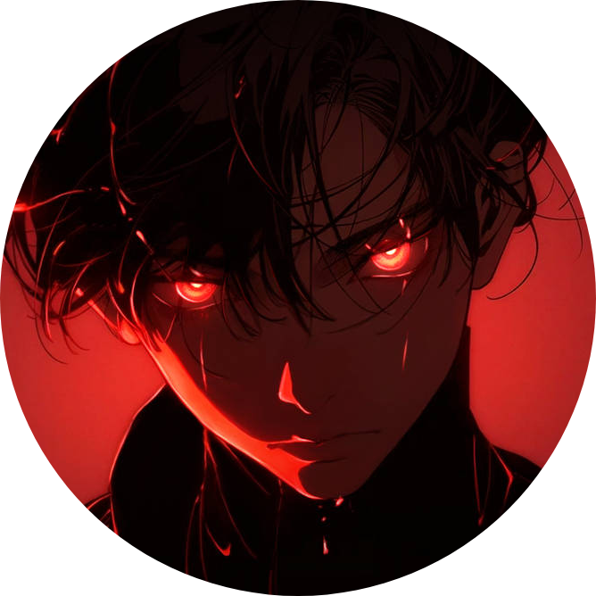

  

  # Hey, I'm Red06Shadow 👋

  **Computer Engineering student from Cuba 🇨🇺**  
  Building a strong foundation in low-level and mid-level software development while exploring Artificial Intelligence.

  
  

## 💻 About me

- 🎓 Studying Computer Engineering in Cuba.
<!-- - 🧠 Learning the fundamentals of Artificial Intelligence and Machine Learning. -->
- ⚙️ Interested in systems programming, software architecture and performance.
- 🌱 Continuously improving my problem-solving and development skills.

## 🛠️ Tech stack

  

## 🚀 Currently learning

- Low-level programming with C and C++
- Object-oriented programming with Java
<!-- - Python for scripting and Artificial Intelligence -->
- Algorithms, data structures and software fundamentals

## 📊 GitHub Statistics

  

  

  ### Thanks for visiting my profile! ⭐

